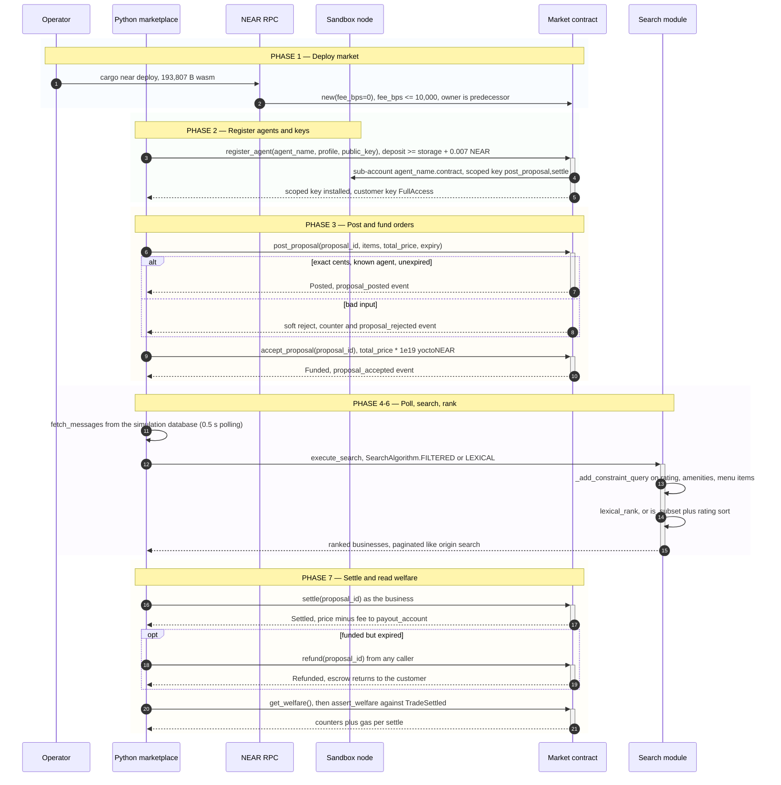

# near-ekklesia

Tracks: `swarms`, `agents` (end 2026-11-14T23:59:00Z) · License: MIT · Baseline: tag `pre-hackathon` @ `126ffe4` ([microsoft/multi-agent-marketplace](https://github.com/microsoft/multi-agent-marketplace)); diff `git diff pre-hackathon..hackathon-submission` · Q-015 sibling **philia** (social on NEAR, tracks `social`, `open`).

Business and customer agents trade in a two-sided market: Rust contracts map orders and payments to native-NEAR escrow, with function-call keys scoped to post and settle. Welfare is emitted as NEP-297 events, so any dashboard can verify outcomes without trusting the operator.



```bash
near account create-account sponsor-by-faucet-service ekklesia.testnet autogenerate-new-keypair save-to-keychain network-config testnet create
cargo near build && cargo near deploy ekklesia.testnet
near contract call-function as-transaction ekklesia.testnet new json-args '{"fee_bps": 0}' prepaid-gas '100 Tgas' attached-deposit '0 N' sign-as ekklesia.testnet network-config testnet sign-with-keychain send
export MARKET_CONTRACT_ID=ekklesia.testnet NEAR_NETWORK=testnet NEAR_RPC_URL=https://test.rpc.fastnear.com
python -m magentic_marketplace.near.bootstrap --network testnet --no-deploy
```

| Do this | See this | Proves |
|---|---|---|
| `uv sync --all-extras` → `bash scripts/demo.sh` | fresh sandbox, `data/demo.db` | quickstart boots in 7 steps |
| `bash scripts/demo.sh` | sandbox, 5 businesses x 20 customers, headline + `refund probe OK` | full loop on chain |
| `near-ekklesia run data/demo_small --near --scripted --experiment-name demo --db-type sqlite --override-db` | scripted SQLite run | on-chain settlement |
| `near-ekklesia analyze data/demo.db --db-type sqlite --near` | origin analytics, welfare assertion | headline verified |
| `bash scripts/measure.sh` | one measured headline, `G = 3.617 TGas` | cost is measured |
| `pytest packages/ekklesia-market/tests/near` | near adapter tests pass | settlement logic tested |
| `get_welfare()` | `W = 1,542,308` USD cents headline | welfare as NEP-297 events |
| `python -m magentic_marketplace.near.bootstrap --network testnet --no-deploy` | testnet registration | deploy path (see bash) |
| `settle` as business FunctionCall key | business FunctionCall key cannot attach the escrow deposit; payout account must hold a FullAccess key | "sandbox and demo only, no real fund, no mainnet deploy; exact cents checked, not truthful YAML" |

[ATTRIBUTION](ATTRIBUTION.md) · [LICENSE](./LICENSE) · [microsoft/multi-agent-marketplace](https://github.com/microsoft/multi-agent-marketplace) · [arXiv 2510.25779](https://arxiv.org/abs/2510.25779)
