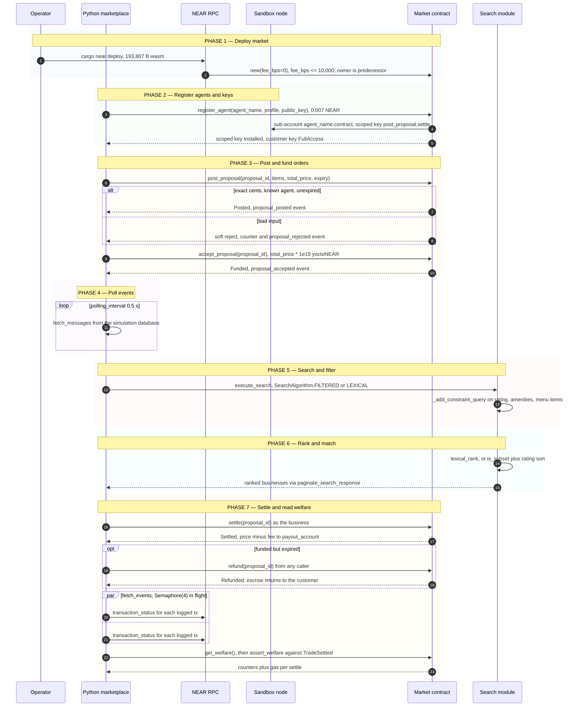

# near-ekklesia

A Rust contract maps `OrderProposal` and `Payment` messages to native-NEAR escrow across per-agent sub-accounts. It emits origin welfare as NEP-297 `EVENT_JSON` logs. Businesses use a FunctionCall key (`post_proposal,settle`). Customers attach escrow with a FullAccess key. Read `get_welfare()` or sum `TradeSettled` events. Port of [microsoft/multi-agent-marketplace](https://github.com/microsoft/multi-agent-marketplace) (MIT), see [ATTRIBUTION.md](ATTRIBUTION.md).



## Quickstart (sandbox tokens only)

Install Docker, Rust 1.100.0 (`rust-toolchain.toml`), Python 3.11+, [uv](https://docs.astral.sh/uv/), Binaryen `wasm-opt` >=116 (`scripts/wasm_opt.sh`). Run `uv sync --all-extras`, `source .venv/bin/activate`, `bash scripts/demo.sh`.

`scripts/demo.sh` runs seven steps. It starts `nearprotocol/sandbox:2.13.4` on `127.0.0.1:3030`, builds `contracts/market` (`wasm32-unknown-unknown`), deploys `ekklesia.sandbox`, and calls `new({"fee_bps": 0})`. It registers `b1..b5.ekklesia.sandbox` and `c1..c20.ekklesia.sandbox`, keys in `.sandbox/agents.json` (`0600`). A deterministic no-LLM market writes `data/demo.db`, then it prints analytics and headline, and posts, escrows, expires, and refunds one proposal. Without Docker, run `near-sandbox --home DIR init` and `near-sandbox --home DIR run`. Export `NEAR_SANDBOX_URL`, `NEAR_ROOT_ACCOUNT`, `NEAR_ROOT_PRIVATE_KEY`, `MARKET_CONTRACT_ID` (e.g. `ekklesia.test.near`). `setup_local.sh` skips Docker for a native node. Peg: `1 NEAR = $1000` (`CENTS_PER_NEAR = 100_000`), so `1` cent is `1e19` yoctoNEAR. No LLM key or real fund is used.

## Do X -> see Y

| Do this | See this |
|---|---|
| `bash scripts/demo.sh` | fresh sandbox, 5x20 agents, `data/demo.db`, headline, `refund probe OK` |
| `near-ekklesia run data/demo_small --near --scripted --experiment-name demo --db-type sqlite --override-db` | scripted SQLite run, on-chain settlement |
| `near-ekklesia analyze data/demo.db --db-type sqlite --near` | origin analytics, on-chain headline, welfare assertion |
| `bash scripts/measure.sh` | `numbers` run, 3 invalid proposals, 1 headline |
| `python -m magentic_marketplace.near.bootstrap --network testnet --no-deploy` | testnet registration via `NEAR_ACCOUNT_ID`/`NEAR_PRIVATE_KEY` |
| `pytest packages/ekklesia-market/tests/near` | exact-cent, fixture, routing, ranking tests (offline) |

`run` writes `data/<experiment_name>.db` by default, `--db-path` overrides, `--override-db` resets the schema. SQLite is default. Postgres: `docker compose up -d postgres`, `--db-type postgres`.

Measured 2026-11-12 by `scripts/measure.sh` on `nearprotocol/sandbox`-equivalent native nearcore 2.14, 5×20, `fee_bps = 0`. Symbol form: `W = 1,542,308` USD cents (`$15,423.08`), `R = 100%`, `N = 20/20`, `G = 3.617 TGas`, medians `K = 23`, `J = 3`. Independent runs: `demo.sh` 20/0, `measure.sh` 23/3. Scale 20×5 differs from paper §4.1 (33/99, 100/300), so W and N are not paper-comparable.
```
Total marketplace customer utility = 1542308; purchase completion rate = 100% (R = 10000/100); needs-met = 20/20; invalid proposals accepted = 0 of 23; soft-rejected = 3; gas/settle = 3.617 TGas
```

## Architecture and contract methods

```text
contracts/market/src/
  lib.rs  Contract state, #[init] new(fee_bps) | types.rs  Role, AgentProfile, OrderItem, Proposal(+Status), TradeReceipt, WelfareCounters, WelfareSummary, StorageKey b"a"/b"p"/b"t"/b"c"/b"n"/b"q"
  settlement.rs  register_agent, post_proposal, accept_proposal, settle, refund | welfare.rs  get_welfare, get_proposal, get_agent, get_trade_count | events.rs  #[near(event_json(standard="ekklesia-market"))]
packages/ekklesia-market/src/magentic_marketplace/
  near/  client.py, adapter.py (NearSettlementProtocol(SimpleMarketplaceProtocol)), events.py, bootstrap.py, refund_probe.py, manipulation_probe.py
  marketplace/agents/  scripted_business.py, scripted_customer.py | experiments/  run_experiment.py, run_analytics.py (--near)
tests/sandbox_market.rs | scripts/fixtures.sh (data/demo_small)
```

Settlement wraps `SimpleMarketplaceProtocol` and delegates each message to the simulation database. `register_agent(agent_name, profile, public_key)` creates `"{agent_name}.{contract}"` for 0.007 NEAR. Business key: `add_access_key_allowance(pk, Unlimited, contract, "post_proposal,settle")`. Customer key: `add_full_access_key(pk)` for escrow in `accept_proposal`. `profile.payout_account` needs FullAccess, so scoped sub-accounts are rejected.

| Method | Caller | Behavior |
|---|---|---|
| `new(fee_bps)` | deployer | `owner` = predecessor, `fee_bps` <= 10,000 |
| `register_agent(agent_name, profile, public_key)` | orchestrator, payable | caps, name, uniqueness checks, storage + 0.007 NEAR |
| `post_proposal(proposal_id, customer, items, total_price, expiry)` | business | non-payable, exact cents, soft reject (counter + event) |
| `accept_proposal(proposal_id)` | customer, payable | `Posted` to `Funded` on exact `total_price * 1e19` before expiry |
| `settle(proposal_id)` | business | `Funded` to `Settled` before transfer (`price - fee` to `payout_account`), emits `trade_settled` + `welfare_snapshot` |
| `refund(proposal_id)` | anyone | `Funded` after expiry to `Refunded`, escrow returned |
| `get_welfare()`, `get_proposal(id)`, `get_agent(id)`, `get_trade_count()` | free | counters, completion bps, average utility, state |

Welfare in cents. First matching trade: `utility += 2 * requested_total_cents - price_cents`. Later trades subtract `price_cents`. `purchasing_customers` counts distinct buyers, `needs_met_count` once. `purchase_completion_bps = purchasing_customers * 10000 / registered_customers`.

Events: `agent_registered`, `proposal_posted`, `proposal_accepted`, `trade_settled`, `proposal_rejected`, `welfare_snapshot`. Python asserts `get_welfare().total_customer_utility_cents == Σ trade_settled.customer_utility_delta_cents`.
```json
EVENT_JSON:{"standard":"ekklesia-market","version":"1.0.0","event":"trade_settled","data":[{"proposal_id":"...","customer":"c1.ekklesia.sandbox","business":"b1.ekklesia.sandbox","price_cents":"15445","fee_cents":"0","needs_met":true,"customer_utility_delta_cents":"18353","business_revenue_delta_cents":"15445"}]}
```

### Testnet and data

```bash
near account create-account sponsor-by-faucet-service ekklesia.testnet autogenerate-new-keypair save-to-keychain network-config testnet create
cargo near build && cargo near deploy ekklesia.testnet
near contract call-function as-transaction ekklesia.testnet new json-args '{"fee_bps": 0}' prepaid-gas '100 Tgas' attached-deposit '0 N' sign-as ekklesia.testnet network-config testnet sign-with-keychain send
export MARKET_CONTRACT_ID=ekklesia.testnet NEAR_NETWORK=testnet NEAR_RPC_URL=https://test.rpc.fastnear.com
python -m magentic_marketplace.near.bootstrap --network testnet --no-deploy
```

Keep testnet keys in your shell or gitignored `.env`. `data/demo_small` (5×20) combines 3 pairs from `competitive_description/contractors_control` plus 2 from `contractors/contractors_10_30` (`business_0005/customer_0002`, `business_0008/customer_0003`), replicated 4 times by `scripts/fixtures.sh`.

## Limits and verification

- **Limits:** sandbox and demo only, no real fund, no mainnet deploy; exact cents checked, not truthful YAML. Orchestrator funds `register_agent`, `owner` and `fee_bps` set at `new`, `payout_account` needs FullAccess, `refund` permissionless, upgrades `#[init(ignore_state)]`.
- **Measured results:** `bash scripts/demo.sh` and `pytest -q` pass, `cargo test --workspace` covers Rust unit vectors and the `near-workspaces` sandbox test; counts and check outputs in [SUBMISSION-PREP.md](SUBMISSION-PREP.md). Raw wasm `234,809 B`, `cargo near build non-reproducible-wasm` `193,807 B`, `scripts/wasm_opt.sh` (`-Oz --converge`) `193,278 B`; cdylib-only `173,555 B` raw, measured, not adopted. `lexical_rank` n=150: `1.85×` faster. `_client_for` 500 lookups: `5.9×` faster.
- **Attribution:** [microsoft/multi-agent-marketplace](https://github.com/microsoft/multi-agent-marketplace) (MIT), [arXiv 2510.25779](https://arxiv.org/abs/2510.25779), [ATTRIBUTION.md](ATTRIBUTION.md), unchanged `LICENSE`. Tracks `swarms` and `agents` end 2026-11-14T23:59:00Z (UTC).
